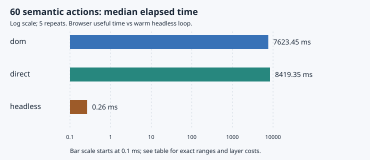

# Foldkit Messages through Bombadil custom actions

This run uses source commit `175ec469a122863b96e07c845ba44a062c6e6cdc`, Foldkit 0.170.0, Effect / platform-browser 4.1.0, Bombadil 0.7.10 and fast-check 4.8.0. Host: Apple M1 Max, darwin arm64, 10 logical CPUs, Bun 1.4.4. Full installed Chrome version 157.0.8103.78, checked from the executable used by Bombadil, is in browser-version.toml; navigator.userAgent is reduced.

## What the PoC proves

Bombadil custom actions can feed user Messages into a real Foldkit browser runtime through a public inbound Port. The bridge calls `Runtime.embed(element).ports.testMessage.send(message)`; `Port.subscriptionEntry` feeds the runtime's Message loop. The bridge never calls update. Real Commands wait in a controlled Effect transport and return their own matching Succeeded/Failed Message. Browser view patches and the real Foldkit Dialog run in both browser paths.

Headless testing deliberately calls the same pure update and interprets its Command descriptors. It simulates successful native Dialog effects. It does not run Foldkit's browser runtime, DOM, focus trap, Mount lifecycle, or browser event mapping.

## Mutant discovery

Each cell is detections / runs, not a coverage claim. Clean and the wiring blind spots are negative controls. Browser runs have a 15-second CLI limit and stop at the first violation. The CLI limit includes some startup; observed useful time is recorded separately. There is no invented Bombadil seed or action-limit option. Headless engines use seeds 1001–1005, 1,000 cases per seed, and traces up to 80 valid semantic actions. Different discovery algorithms and length distributions prevent a fair speed ranking from this table.

| Engine | Clean | Stale response | Duplicate pending | Dialog recovery | DOM wiring |
|---|---:|---:|---:|---:|---:|
| dom | 0/5 | 5/5 | 5/5 | 2/5 | 5/5 |
| direct | 0/5 | 5/5 | 5/5 | 2/5 | 0/5 |
| effect-arbitrary | 0/5 | 5/5 | 5/5 | 5/5 | 0/5 |
| fast-check | 0/5 | 5/5 | 5/5 | 5/5 | 0/5 |

The wiring mutant changes the Next page button's Foldkit OnClick Message. A separate test-only DOM capture observer records the control's declared intended page before Foldkit handles the click. Direct Port sends and headless calls skip that observer, so their zero wiring detections are expected. This is one explicit wiring check, not a proof of all DOM wiring.

| Engine | Mutant | Detected | Median time to violation (ms) | Median cumulative actions to violation |
|---|---|---:|---:|---:|
| dom | stale | 5/5 | 1809.22 | 11 |
| dom | duplicate | 5/5 | 584.89 | 5 |
| dom | recovery | 2/5 | 6590.46 | 45 |
| dom | wiring | 5/5 | 663.43 | 4 |
| direct | stale | 5/5 | 3552.30 | 22 |
| direct | duplicate | 5/5 | 1033.94 | 4 |
| direct | recovery | 2/5 | 6766.53 | 49 |
| direct | wiring | — | — | — |
| effect-arbitrary | stale | 5/5 | 1.47 | 123 |
| effect-arbitrary | duplicate | 5/5 | 0.23 | 13 |
| effect-arbitrary | recovery | 5/5 | 1.28 | 206 |
| effect-arbitrary | wiring | — | — | — |
| fast-check | stale | 5/5 | 0.30 | 57 |
| fast-check | duplicate | 5/5 | 0.09 | 5 |
| fast-check | recovery | 5/5 | 0.58 | 154 |
| fast-check | wiring | — | — | — |

Browser time starts at its first state snapshot; headless time starts before generation and includes earlier passing cases. Headless cumulative actions include all earlier cases, while browser actions belong to one uninterrupted run. The two columns therefore describe each engine and are not matched discovery work. Original failing trace lengths are stored separately.

## Same semantic trace

The initial 15-second fixed-trace series completed 9/10 browser runs. All original attempts remain in the main evidence directory. A follow-up repeated ALL ten browser comparisons at 30 seconds; the table below uses that complete follow-up, with the same 60-action trace and original warm headless measurements. This avoids selecting only successful original attempts. Follow-up source/config: measurements/2026-11-12-fixed30/environment.toml. Each repeat targets exactly 60 semantic actions, observes 40 application Messages, issues 20 FetchPage Commands, and ends at the same Model. Every action is issued separately. Delay is one logical-clock action and emits no Message; each reply settles one already-issued Command. No 100-Message batch is counted as one action. The browser specs use an explicit `traceComplete` stop property after action 60; that deliberate stop is excluded from bug detection counts.

| Engine | Repeats | Median useful ms (min–max) | Semantic actions/s | Median wall ms | Median startup-to-first-snapshot ms | Complete and same final Model |
|---|---:|---:|---:|---:|---:|---|
| dom | 5 | 7623.45 (6640.32–10519.39) | 7.87 | 10081.73 | 2365.02 | yes |
| direct | 5 | 8419.35 (7732.53–9201.77) | 7.13 | 11178.34 | 2718.31 | yes |
| headless | 5 | 0.26 (0.20–0.53) | 227920.23 | not measured | not measured | yes |

Browser useful time includes Bombadil action selection, Chromium input/custom-action execution, runtime work, rendering, instrumented coverage collection, extractors and screenshot capture. Custom actions also wait for bridge acknowledgement and render convergence. Headless time is warm in-process update + test interpreter + oracle only. This is a cost-of-exercised-layers comparison, not a claim that one discovery algorithm is better or that direct dispatch replaces DOM tests. Tiny headless timings have coarse relative resolution; no cross-machine claim follows.

Clean discovery throughput (descriptive only):

| Engine | Median semantic actions/s | Median snapshots/s | Median startup ms |
|---|---:|---:|---:|
| dom | 6.15 | 6.23 | 3216.28 |
| direct | 6.99 | 7.08 | 3626.78 |
| effect-arbitrary | 85926.56 | not a browser state | not measured |
| fast-check | 62349.00 | not a browser state | not measured |

## Trigger coverage

Counts below sum the five clean discovery runs. They count precondition-triggered checks, not distinct states or exhaustive coverage. Runtime checks latch violations on every observed update transition, including reply Messages between Bombadil snapshots. Native Dialog Mount cleanup Messages may differ from the explicit headless interpreter and are not claimed equivalent. Page data checks only run on Success; stale checks only on superseded replies; recovery checks only on dismissal after failure. The fixed speed trace deliberately has no failure branch and is not a coverage test.

| Engine | Reply pending | Stale ignored | Pending guard | Recovery | Page data | DOM wiring |
|---|---:|---:|---:|---:|---:|---:|
| dom | 91 | 80 | 162 | 1 | 7 | 60 |
| direct | 116 | 97 | 161 | 5 | 19 | 0 |
| effect-arbitrary | 19385 | 16187 | 39321 | 785 | 2288 | 0 |
| fast-check | 1634 | 875 | 6308 | 155 | 439 | 0 |

The summary TOML also includes per-action coverage. Search discovery uses the same three query presets (all/a/b), page controls, refresh, logical delay, oldest/newest success/failure, dismiss and retry. The text input supports arbitrary search and has a Scene test, but random browser benchmarks restrict their actions to these matched presets.

## Shrinking and replay

Browser representatives: 24/24 replay attempts reproduced a latched model/wiring violation, including shrunk-trace replays where available. Each representative gets three attempts. No replay success is inferred from exit status alone.

| Browser path (stale mutant) | Before actions | After actions | Shrink wall ms | Retained violation |
|---|---:|---:|---:|---|
| direct | 32 | not produced | 22413.53 | false |
| DOM | 13 | 13 | 20296.77 | true |

Bombadil shrinking is experimental and gets a 20-second CLI limit. Calibration and confirmation can consume most of that time; wall elapsed is recorded. Logs show any timeout, replay divergence, or failure. Full original and shrunk JSONL traces stay byte-for-byte as Bombadil wrote them. Screenshots/downloads are omitted; JSONL image references are therefore not shipped.

| Headless engine | Mutant | Median before actions | Median after actions | Median shrink-and-return ms |
|---|---|---:|---:|---:|
| effect-arbitrary | stale | 6 | 4 | 1.35 |
| effect-arbitrary | duplicate | 2 | 2 | 0.23 |
| effect-arbitrary | recovery | 6 | 4 | 1.46 |
| fast-check | stale | 7 | 4 | 2.79 |
| fast-check | duplicate | 3 | 2 | 0.21 |
| fast-check | recovery | 6 | 4 | 1.32 |

Native/fast-check counterexample replay: 90/90. Native Effect Arbitrary records its own seed, initial input, shrunk input and replay token. fast-check records its seed/path, first failing semantic trace and final counterexample; its first raw choice vector is not exposed by this runner. Shrink timing is elapsed after the first failure through check return, so it includes result assembly. Shrinking can change the valid-action mapping as prior actions disappear; every candidate is interpreted anew and must still fail.

## Conclusions

The runtime seam works with stock Foldkit and Bombadil, without a framework patch. On the matched trace, the direct/DOM median useful-time ratio is 1.10; this small shared-host sample does not establish a general speed advantage. The useful difference is control over valid Messages and response ordering. Keep DOM checks for input wiring and native interaction, direct browser checks for runtime/Command/render behavior, and native Arbitrary for large transition searches and shrinking.

## Controls and limits

- The server binds only 127.0.0.1. There is no vendor API, account, secret, product code or customer data. A fixed 12-item catalogue is the only data. CSP permits only local script/network resources. Dependencies/Chrome setup may require downloads before testing.
- Every browser run uses a fresh browser/document and initial Model. This resets request ids, the response queue, logical clock, oracle and action counters. No random response timing or wall-clock delay controls the app. Headless starts a new interpreter per generated case.
- Pending replies correspond to real Command descriptors/continuations. Search changes may supersede an earlier request; old responses can still arrive, and the stale oracle checks that they do not change the current result.
- The measured series predates a final Dialog panel CSS repair. For exact timing/discovery reproduction use the source commits in each environment file. A separate final-recovery evidence directory tests the final presentation with a deterministic four-action clean/mutant trace on both browser paths; it is not used for speed statistics.
- The bridge is emitted only in the test build. The production entry has no window bridge, inbound test subscription or transport controls. It remains a fixture with no live backend.
- In the initial runner, stdout/stderr opened the same log path separately. The direct shrink error overwrote part of its stdout text. The later runner uses one shared file descriptor; the original JSONL traces and measurement TOML are unaffected.
- Five serial repeats are a small sample on a shared laptop. Run order alternates DOM/direct. There are no confidence intervals, dedicated-host isolation, independent Bombadil seeds, byte-identical browser RNG, or claims of complete state/Message coverage.
- Headless setup/import startup is not separately measured. Chrome-tree CPU/RSS, energy, cloud cost and human authoring time are not measured. No dollar-cost claim is made. Hegel is not evaluated.
- The live bridge waits for the rendered Model snapshot to converge. That is not a proof that every visible list, label or native interaction matches the Model; Scene tests and the wiring control check selected UI behavior.
- Direct dispatch validates model/runtime/Command behavior on this semantic action set. DOM tests add event wiring and browser input. Headless tests provide many cheap transition checks and shrinkable traces, while replacing platform effects. Keep the three roles distinct.

## Evidence and reproduction

Raw evidence: [`measurements/2026-11-12-m1max`](../measurements/2026-11-12-m1max/), [`measurements/2026-11-12-fixed30`](../measurements/2026-11-12-fixed30/), [`measurements/2026-11-12-final-recovery`](../measurements/2026-11-12-final-recovery/). [Summary TOML](../measurements/2026-11-12-m1max/summary.toml), environment, per-run TOML, process logs and untouched Bombadil trace JSONL are committed. Run `mise exec -- bun scripts/report.ts measurements/2026-11-12-m1max measurements/2026-11-12-fixed30 measurements/2026-11-12-final-recovery` to rebuild this report and its chart from raw evidence. See [README](../README.md) for clean setup and fresh benchmarks.
